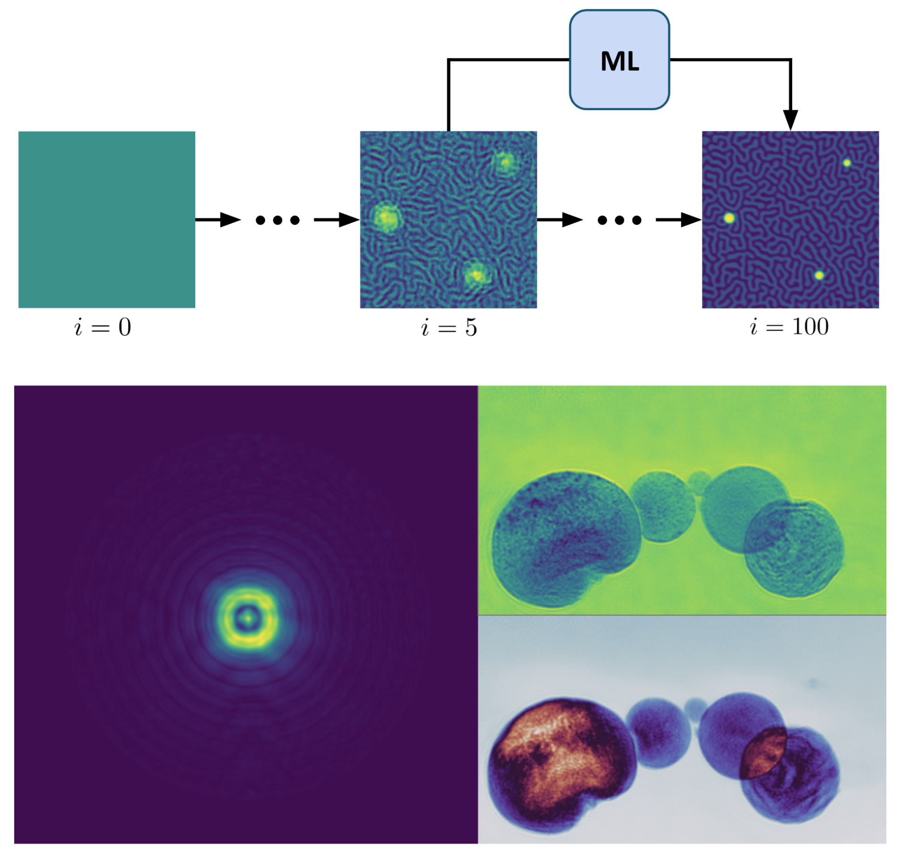

# Hi, I'm Bowen 👋

I'm a computational scientist working at the intersection of **machine learning, software engineering, agentic AI, and GPU computing**.

I turn complex data into faster answers, building **ML-accelerated image reconstruction** and **AI agents** end to end, from **data pipelines** and model training to **tested APIs** and **MLOps**.

## 🔬 What I work on

<table>
  <tr>
    <th width="50%">AI/ML for production scientific imaging (published in IUCrJ)</th>
    <th width="50%">Reasoning-LLM Agent for Enterprise RAG</th>
  </tr>
  <tr>
    <td></td>
    <td></td>
  </tr>
  <tr>
    <th width="50%">Agentic Data Platform</th>
    <th width="50%">Federated Agent Deployment</th>
  </tr>
  <tr>
    <td></td>
    <td></td>
  </tr>
</table>

## Selected Contributions

### 🔬 CDTools — ML-Accelerated Ptychographic Reconstruction

Developed an ML-augmented reconstruction capability using [CDTools](https://github.com/cdtools-developers/cdtools), a framework for iterative ptychographic image reconstruction.

**Python · PyTorch · CUDA · Multi-GPU · HPC · Scientific ML**

- Developed and integrated a **U-Net fast-forward operator** that advances early-stage ptychographic reconstructions toward convergence while retaining subsequent physics-based iterative refinement.
- Trained and evaluated the model using **7,446 historical experimental datasets** from the Advanced Light Source, including cross-year testing on independently acquired data.
- Implemented and benchmarked **GPU and multi-GPU reconstruction workflows**, evaluating scaling from 1 to 4 GPUs.
- Integrated the ML-augmented method into the **production reconstruction workflow at an ALS beamline**, enabling substantially faster feedback for ptycho-tomography and other high-throughput experiments.

📄 **First-author paper:** *Machine Learning–Augmented Acceleration of Iterative Ptychographic Reconstruction* — accepted for publication in **IUCrJ**.

### 🤖 Agentic AI Workbench for Scientific Scattering

Developed an AI-enabled scientific workbench for browsing, analyzing, and reasoning over **GIWAXS/SAXS experimental data**.

**React · TypeScript · FastAPI · Tiled · LangGraph · MCP · Docker · Ollama/vLLM**

- Integrated a **Tiled scientific data catalog** with interactive GIWAXS/SAXS visualization and analysis tools.
- Built a **LangGraph-based AI assistant** for natural-language interaction with experimental data and scientific tools.
- Integrated **knowledge-graph construction, querying, and visualization** across samples, materials, and publications.
- Developed a modular full-stack architecture connecting the React frontend with FastAPI services for data access, scientific analysis, and AI agents.
- Exposed scientific tools through **Model Context Protocol (MCP)** for use by agentic AI workflows.

*Internal ALS Computing project.*

### 🧠 FAIR2WISE — Distributed Term Extraction on HPC

Contributed to [FAIR2WISE](https://github.com/fair2wise/FAIR2WISE) by developing a distributed workflow for running LLM-based scientific term extraction using GPU resources on remote HPC systems.

**Python · Academy Agents · Globus Compute · LangGraph · HPC · LLMs**

- Integrated the LangGraph term-extraction pipeline with **Academy Agents and Globus Compute** for remote execution on HPC systems.
- Built local and remote agents for **remote execution, task coordination, and status monitoring**.
- Implemented real-time streaming of logs and CPU, memory, and GPU metrics from remote jobs.
- Enabled concurrent processing of scientific documents and aggregation of extracted terminology for downstream knowledge-representation workflows.

Implemented in the [`bowen/academy_agent`](https://github.com/fair2wise/FAIR2WISE/tree/bowen/academy_agent) branch.

## 🛠 Technologies

Python · PyTorch · LLM/vLLM · Agentic AI · Optimization · SQL · Linux · Slurm · Docker · FastAPI · React · LangGraph · MCP
