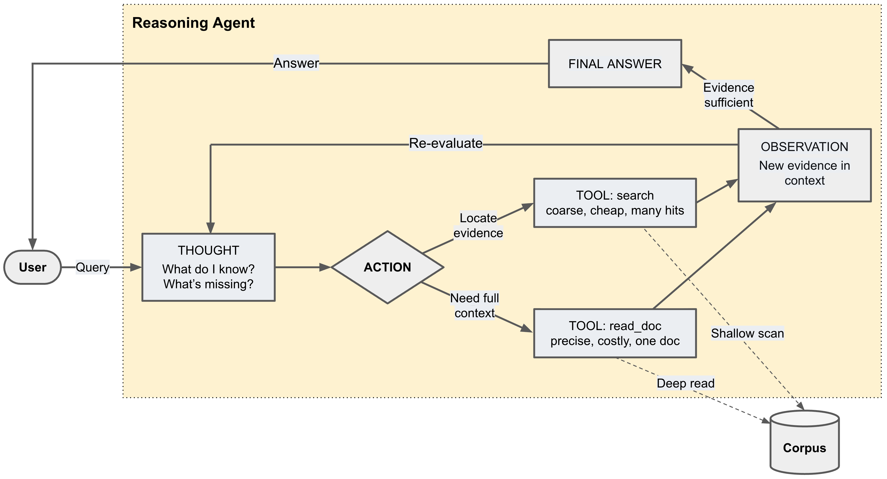
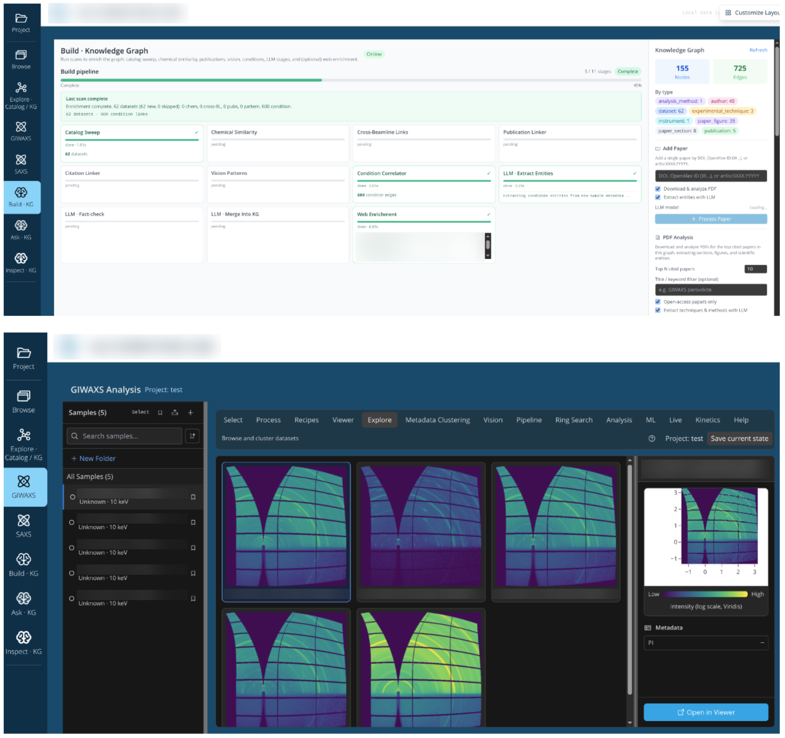
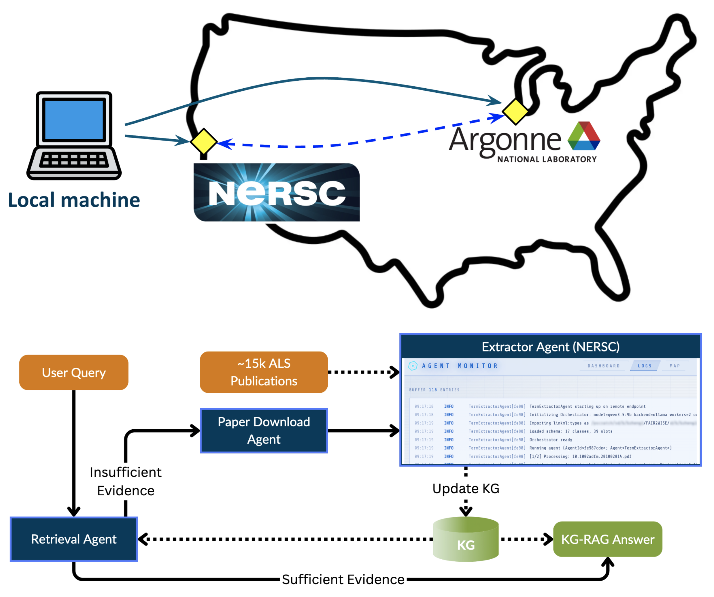

# Hi, I'm Bowen 👋

I'm a computational scientist working at the intersection of **machine learning, software engineering, agentic AI, and GPU computing**.

I turn complex data into faster answers, building **ML-accelerated image reconstruction** and **AI agents** end to end, from **data pipelines** and model training to **tested APIs** and **MLOps**.

## 🔬 What I work on

<table>
  <tr>
    <td width="40%"></td>
    <td width="60%" valign="top">

### AI/ML for production scientific imaging (online soon in IUCrJ)

Integrated ML-accelerated ptychographic reconstruction into the **production workflow at an ALS beamline**, achieving a **2× speedup with improved quality** over legacy methods.

**Python · PyTorch · Deep Learning · Computer Vision · CUDA · Multi-GPU · Prefect · Docker**

📄 First-author paper in **IUCrJ**: *Machine Learning–Augmented Acceleration of Iterative Ptychographic Reconstruction* ([DOI](https://doi.org/10.1107/S2052252526010419))

<b>Details</b>

- Developed a **U-Net fast-forward operator** in [CDTools](https://github.com/cdtools-developers/cdtools) that is applied once after a short warm-up, then hands back to the physics-based solver. Inference takes about **3.7 ms**, 0.2–0.3% of a single iteration.
- Trained on **32 NVIDIA A100 GPUs** at NERSC using **7,446 experimental datasets** from the Advanced Light Source.
- Tested on **100 samples from different years** than the training data, achieving comparable or improved reconstruction quality with faster convergence (**1.5–2× speedup** per reconstruction).
- Benchmarked **multi-GPU reconstruction**: **2.6× speedup on 4 GPUs** (65% parallel efficiency), with only 1.5–4.2% ML overhead relative to the standard solver.
- Deployed to production with **Prefect**-based, GPU-aware orchestration: shared data ingestion for standard and ML pipelines, **Docker**-based reconstruction tasks, and GPU queuing with file-based locking.
- Cut ptycho-tomography time per projection from **~153 s to ~41 s (~4×)** on a 74-projection dataset, compared with the default 200-iteration workflow.

</td>
  </tr>
  <tr>
    <td width="40%"></td>
    <td width="60%" valign="top">

### Reasoning-LLM Agent for Enterprise RAG

An LLM agent that **plans its searches**, **reads full documents**, and **decides when it has enough evidence** to answer.

It raised the score over single-shot RAG from **0.529 to 0.745** on 500 [EnterpriseRAG-Bench](https://github.com/onyx-dot-app/EnterpriseRAG-Bench) questions (2,723-document subset).

**Python · FAISS · Ollama · FastAPI · React · TypeScript · MLflow · DVC · AWS (S3, EC2) · Docker · GitHub Actions**

🔗 Code: [TechRAG](https://github.com/BOWENmeZHENG/TechRAG)

<b>Details</b>

- Built a bounded **agentic search loop** with `search` and `read_doc` tools and step, context, and duplicate-call limits, without an agent framework.
- Implemented **dense, BM25, and hybrid retrieval**, served through a FastAPI API and a React web UI.
- Added **MLflow** run tracking, tests, CI, and Docker packaging, with **DVC** data and index versioning backed by **AWS S3** on the [`dvc-version`](https://github.com/BOWENmeZHENG/TechRAG/tree/dvc-version) branch.
- 95% bootstrap CI for the gain: +0.176 to +0.256, at about 1.6× the time per question. The same local model answered and judged.

</td>
  </tr>
  <tr>
    <td width="40%"></td>
    <td width="60%" valign="top">

### Unified Agentic Platform for Scientific Data

An AI-enabled workbench for browsing, analyzing, and reasoning over **X-ray experiment data** that reveals the structure of materials.

**AI Agents · LLMs · LangGraph · MCP · Knowledge Graphs · React · TypeScript · FastAPI · Docker**

🔒 Code not publicly available

<b>Details</b>

- Built a **LangGraph AI assistant** that lets users explore data and run scientific tools by asking in plain language, with tools connected through **MCP**.
- **Enabled interactive analysis** of X-ray scattering data (GIWAXS/SAXS) on a **live data server** (Tiled), with processed results **written back** to it.
- Added a **knowledge graph** that maps connections between samples, materials, and publications (sourced from **OpenAlex**), which users can build, search, and visualize.
- Built an **automated pipeline** that grows the knowledge graph from the data catalog and research papers, using an **LLM to extract and fact-check** key information.
- Designed a **modular web application** that links the user interface (React) to separate backend services (FastAPI) for data access, analysis, and AI.

</td>
  </tr>
  <tr>
    <td width="40%"></td>
    <td width="60%" valign="top">

### Federated Agent Deployment for Scientific Knowledge Extraction

An LLM agent that **extracts scientific terms from research papers** on **high-performance remote servers**, which you can **launch, monitor, and interact with** from your own computer. Contributed to [FAIR2WISE](https://github.com/fair2wise/FAIR2WISE).

**Python · LLMs · LangGraph · Distributed Computing · Multi-Agent Systems · Remote Execution**

🔗 Code: [`bowen/academy_agent`](https://github.com/fair2wise/FAIR2WISE/tree/bowen/academy_agent) branch

<b>Details</b>

- Built a **LangGraph AI agent** that uses tools to check, clean up, and organize the information it extracts.
- Verified the AI's results against **predefined rules** and processed multiple pages **in parallel**.
- Used [**Academy Agents**](https://academy-agents.org/) and [**Globus Compute**](https://www.globus.org/compute) to send tasks to remote servers and get results back.
- Added a **live dashboard** to track progress and computing resource use.

</td>
  </tr>
</table>

## 🛠 Skills

- **Languages:** Python · TypeScript · SQL
- **Machine learning:** PyTorch · Deep Learning · Computer Vision · Optimization · CUDA · Multi-GPU Computing
- **LLMs and agents:** Agentic AI · Multi-Agent Systems · RAG · LangGraph · MCP · Knowledge Graphs · FAISS · LLM Evaluation · vLLM · Ollama
- **Software engineering:** FastAPI · REST APIs · React · Concurrency Control · pytest · Git
- **MLOps and infrastructure:** Production ML Deployment · Data Pipelines · Workflow Orchestration · Distributed Computing · Prefect · Containerization · Docker · AWS (S3, EC2) · GPU Scheduling · Edge Computing · GitHub Actions · MLflow · DVC · Linux · Slurm
